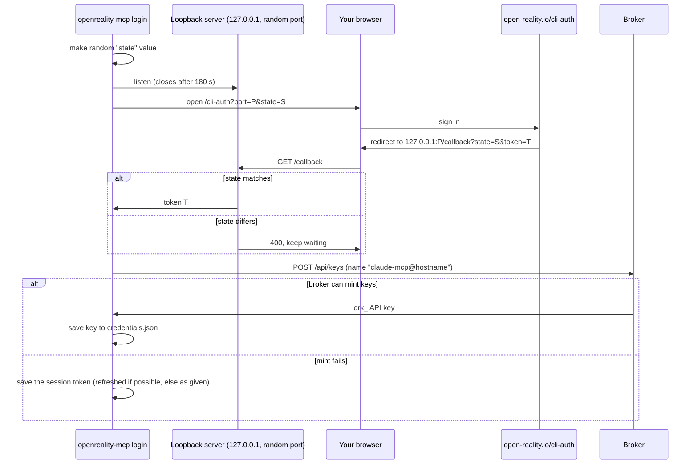
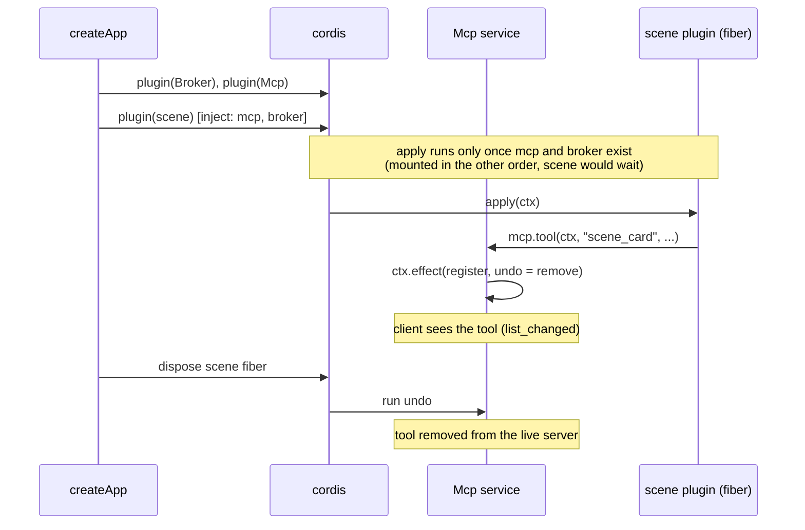
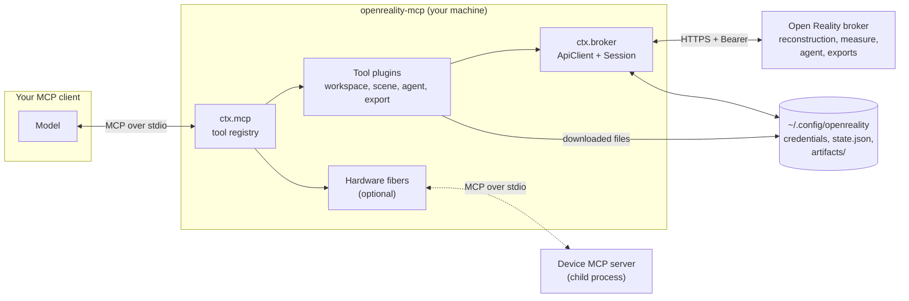
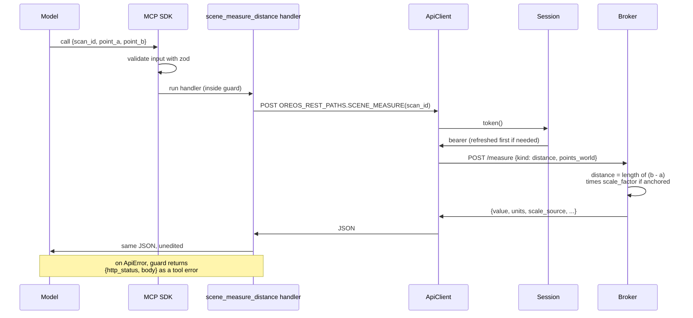
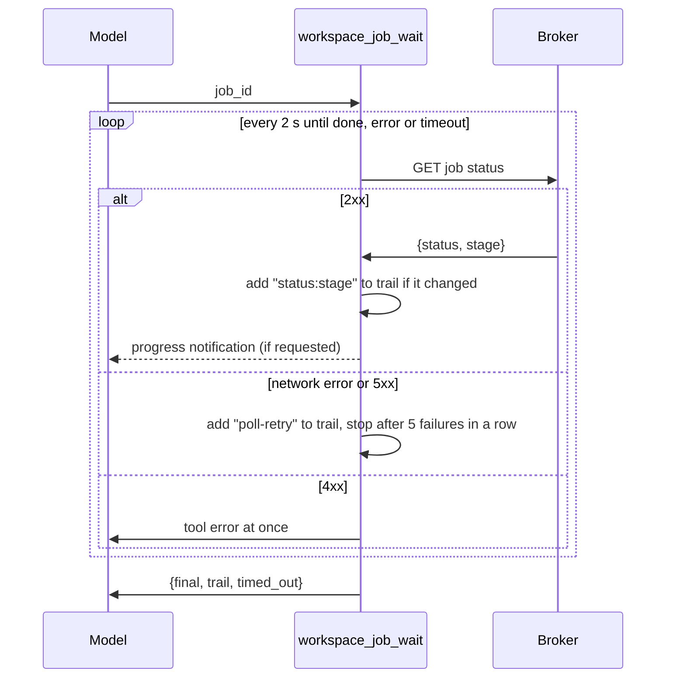
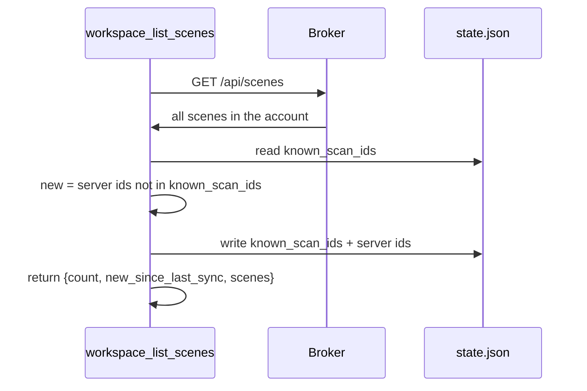
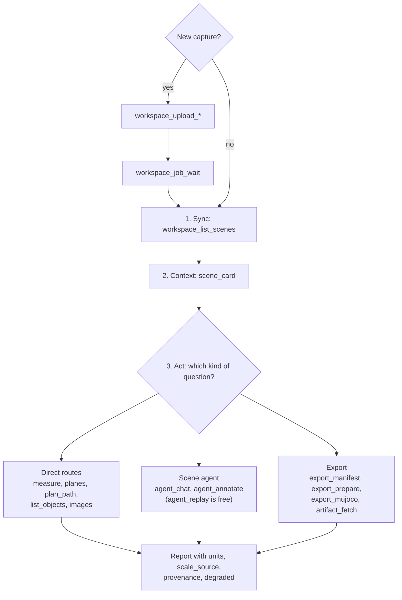
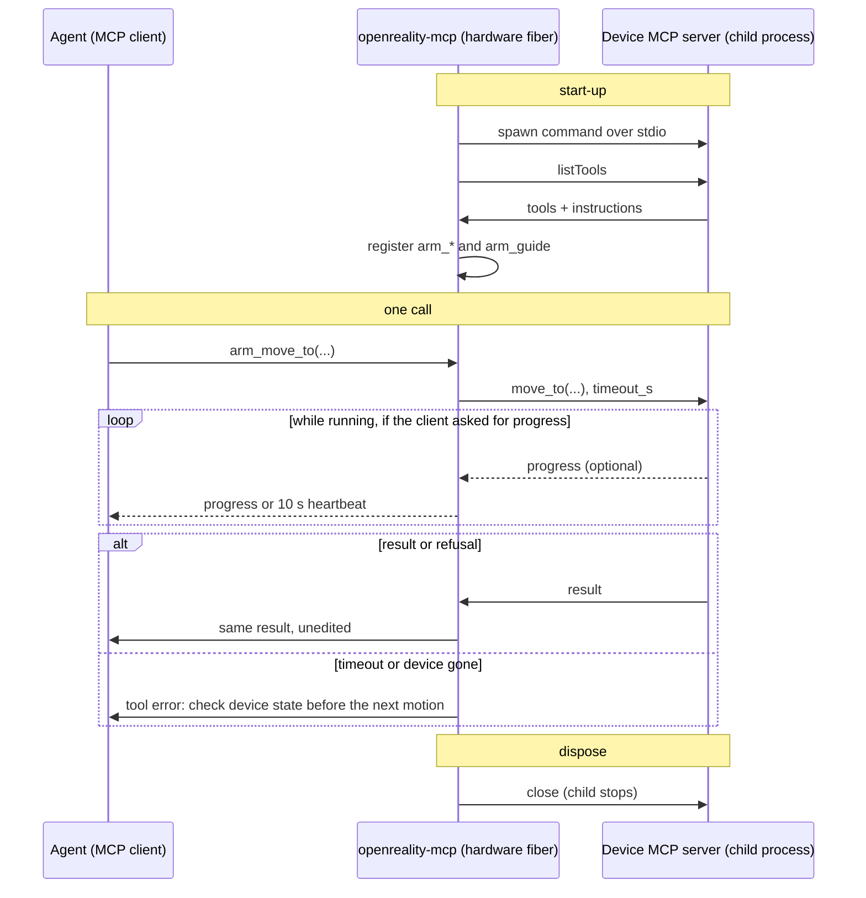

# openreality-mcp: architecture

_Writers: TBD, TBD · Last reviewed: TBD_

This doc explains how `openreality-mcp` is built: which parts exist, how one
tool call travels through them, and how to change them safely. It builds on the
"Architecture" section of the [README](../README.md#architecture-an-all-plugin-cordis-app),
which it does not repeat. Code is linked as `path:Symbol`; open the file and
search for the symbol.

**Sections 1 to 3 are the first read, about 20 minutes. Sections 4 to 7 are
reference; open them when you need them.** Unfamiliar words are defined in
[section 7](#7-words-used-in-this-doc).

## 1. What this package does

`openreality-mcp` is an MCP server, published on npm, that gives a coding agent
tools to upload a video, wait for it to become a 3D scene, query that scene
(measure it, plan paths through it, ask the server's scene agent about it) and
export it for robot training. MCP (the
[Model Context Protocol](https://modelcontextprotocol.io)) is a standard way
for an AI assistant to call tools that live outside it. The package is a thin
typed client: it runs on your machine, started by your MCP client over stdio
(standard input and output), and sends every call to the Open Reality server
API, the **broker** in [`../../server`](../../server), where all real work
happens. It supports Claude Code, Codex and Cursor, which run
`npx -y openreality-mcp serve`, and the Claude Desktop extension, which runs
its bundled `node dist/cli.js serve`. All of them share one sign-in.

How each client installs it (full steps in the README):

| Client | How | README section |
|---|---|---|
| Claude Code | `claude mcp add` or a Claude Code plugin | [Install: Claude Code](../README.md#install-claude-code) |
| Claude Desktop | one-click `.mcpb` extension file | [Install: Claude desktop](../README.md#install-claude-desktop) |
| Codex | `codex mcp add` or `~/.codex/config.toml` | [Install: Codex](../README.md#install-codex) |
| Cursor | deeplink or `mcp.json` | [Install: Cursor](../README.md#install-cursor) |

## 2. Key components

### CLI and start-up

- **Responsibility:** parse the subcommand and start the right thing.
- **Entry point:** [`src/cli.ts:main`](../src/cli.ts), the `bin` of the package
  (built to `dist/cli.js`). [`src/index.ts`](../src/index.ts) is only the
  library export list for embedders and tests.
- **Subcommands:** `serve` (the default, what MCP clients run), `login`,
  `keys list`, `keys revoke <id>`, `whoami`, `simulator`.
- **Key method:** `serve` calls `createApp(config, loadHardware(config.configDir))`
  and then `ctx.mcp.connect(new StdioServerTransport())`. From that moment the
  process answers MCP requests on stdin and stdout, so it must never print
  anything else to stdout.

### Config

- **Responsibility:** turn environment variables into one `Config` object.
- **Where:** [`src/config.ts:loadConfig`](../src/config.ts).
- **How:** the first variable that is set wins:

| Setting | Variables, in order | Default |
|---|---|---|
| Broker URL | `OPENREALITY_URL`, `DEMO_BROKER_URL` | the hosted broker |
| Token | `OPENREALITY_TOKEN`, `DEMO_AUTH_TOKEN` | none (use the credentials file) |
| Login page | `OPENREALITY_LOGIN_URL` | `https://open-reality.io` |
| State folder | `OPENREALITY_DIR` | `~/.config/openreality` |
| Downloads | `OPENREALITY_ARTIFACTS_DIR` | `<state folder>/artifacts` |
| Hardware list | `OPENREALITY_HARDWARE` | `<state folder>/hardware.json` if it exists |

The `DEMO_*` names are older spellings that deployed systems still send. They
are a **persisted contract**: never rename or remove them.

The state folder holds `credentials.json` (written with file mode 0600, so only
you can read it), `state.json` (the sync cursor: which scenes this machine has already seen),
the `artifacts/` folder, and
the optional `hardware.json`.

### Login and session

- **Responsibility:** get a credential once, keep it valid, and attach it to
  every request.
- **Where:** [`src/login.ts`](../src/login.ts) (browser hand-off),
  [`src/cli.ts:loginWithBrowser`](../src/cli.ts),
  [`src/session.ts:Session`](../src/session.ts).
- **Two kinds of credential:**
  - An **API key** starts with `ork_`. It is durable: it never expires, never
    refreshes, and is only ended by `keys revoke`. This is what `login` creates.
  - A **session token** (a short-lived signed token from the sign-in provider,
    or an older broker session token) expires. `Session.token()` swaps it for
    a fresh one once less than half of its life is left, using
    `POST /api/session/refresh`. Two tool calls that need a refresh at the
    same time share one refresh request.
- **Precedence:** a token from the environment beats the credentials file.

`login` without `--token`, and without `OPENREALITY_TOKEN` set, runs a browser
hand-off. A "loopback" server is a tiny web server on your own machine
(127.0.0.1) that only the browser redirect can reach:



The random `state` value proves that the callback came from the sign-in this
command started, not from another page. The key name includes your machine's
host name so `keys list` shows which machine owns which key.

### HTTP client

- **Responsibility:** every request to the broker.
- **Where:** [`src/http.ts:ApiClient`](../src/http.ts), shared through the
  broker service [`src/services/broker.ts:Broker`](../src/services/broker.ts),
  which bundles `config`, `session` and `client` as `ctx.broker`.
- **Rules it applies to every call** (this is the one place they are stated):
  - Adds `Authorization: Bearer <token>`.
  - **401 (not signed in):** refresh the session once and re-send the request
    once, POST included, since the server refused it before doing anything.
    Two exceptions: an API key has nothing to refresh, so the call fails with
    a message telling you to run `openreality-mcp login` again; and a streamed
    file upload (`uploadFile`) is re-sent but the re-send fails, because its
    body is a one-time stream the first attempt already used up (see section
    6).
  - **Network failure:** a GET is tried 3 times, waiting 250 ms and then
    500 ms. A POST is never retried, because it may start work and repeating
    it could start that work twice.
  - Errors are thrown as `ApiError`. JSON error bodies are kept whole;
    non-JSON bodies are kept as `{raw}`, cut to 2,000 characters.

### Plugin composition (cordis)

The server is built with [cordis](https://github.com/cordiverse/cordis), a
plugin framework. Three ideas matter here:

- A **service** is a shared object other plugins can ask for. There are two:
  `ctx.broker` (above) and `ctx.mcp` ([`src/services/mcp.ts:Mcp`](../src/services/mcp.ts)),
  which owns the MCP server object from the official SDK.
- A **plugin** is a module that exports `name`, `inject` (the services it
  needs) and `apply(ctx)`. Cordis does not run `apply` until every service in
  `inject` exists. Each loaded plugin runs in its own **fiber**, cordis's word
  for one loaded copy of a plugin that can be unloaded on its own.
- An **effect** is a change paired with its undo. `ctx.mcp.tool(ctx, ...)`
  registers a tool through `ctx.effect()` and hands the SDK's `remove()` back
  as the undo. Unloading the fiber runs every undo it collected.

Adding or removing a tool while a client is connected sends the client a
"list changed" message, so it refreshes its tool list. The MCP SDK normally
refuses to turn on its "tools" feature after a client has connected, so the
`Mcp` constructor registers and removes a dummy `__cordis_init__` tool and
resource before connecting. That is what lets plugins come and go later.



[`src/app.ts:createApp`](../src/app.ts) is only a list of plugins, mounted
services first. Tests and embedders can mount any subset in any order;
`test/cordis.test.ts` checks that disposing one namespace removes exactly its
tools, and that a plugin mounted before its services stays pending until they
exist. Service configs are checked with zod (a TypeScript schema library) when
the plugin loads, so a bad config fails at start-up, not on the first tool
call.

### Tool helpers

- **Where:** [`src/toolkit.ts`](../src/toolkit.ts).
- **Result shaping:** `jsonResult`, `textResult`, and `imageResult` (an image
  sent inline as base64 with an optional caption).
- **`guard(fn)`:** wraps every handler. An `ApiError` becomes a tool error
  whose text is `{http_status, body}` with the server's body unchanged, plus
  `message` when the error carries a more useful one (such as the hint to log
  in again after a revoked key). Typed refusals (409, 422) reach the model word
  for word.
- **Job polling:** `pollWorkspaceJob` and `pollSceneJob` (both built on
  `pollJobPath`) return `PollOutcome {final, trail, timed_out}`. Details in
  section 3.
- **`progressTick`:** sends MCP progress notifications while a wait runs, if
  the client asked for them.

### Vendored wire contract

A **wire contract** is the exact shape of what travels between two programs:
URL paths, request bodies, response bodies. Open Reality keeps it as one
TypeScript package, `@reality/protocol`, owned by the private web repo. Because
this repo is public and must build on its own, a copy lives in
[`vendor/protocol/`](../vendor/protocol). "Vendored" means copied into the repo
instead of installed from a registry.

- Tools build URLs with its route builders (`REST_PATHS`, `OREOS_REST_PATHS`),
  never by hand.
- The build bundles it into `dist/cli.js`, so users never install it.
- Never edit it here. The sync procedure and the commit it was copied from are
  in [`vendor/protocol/README.md`](../vendor/protocol/README.md).

### Tool groups

42 built-in tools in four plugins, plus two resources. The full list is the
README [tool table](../README.md#tool-surface-42-tools).

| Plugin | Tools | Purpose |
|---|---|---|
| [`src/plugins/workspace.ts`](../src/plugins/workspace.ts) | 6 | list scenes (with the sync cursor), upload video, robot recording or splat, wait for ingest jobs |
| [`src/plugins/scene.ts`](../src/plugins/scene.ts) | 23 | scene card, measure, planes, paths, anchor, objects, images, segmentation, sharing, scene jobs |
| [`src/plugins/agent.ts`](../src/plugins/agent.ts) | 6 | run, replay and inspect the server-side scene agent |
| [`src/plugins/export.ts`](../src/plugins/export.ts) | 7 | build exports and download artifacts to disk |
| [`src/plugins/resources.ts`](../src/plugins/resources.ts) | 2 resources | `openreality://scenes` and `openreality://scene/{scan_id}` |

`export_mujoco` is the one **composite** tool: a single call prepares (or
reuses a fresh) `mujoco_mjcf` export, waits for it, downloads it, unpacks it
with [`src/unzip.ts:extractZip`](../src/unzip.ts) and returns the path to
`scene.xml`.

### Scene card

- **Responsibility:** a short, honest summary of one scene for the model to
  read before acting.
- **Where:** [`src/card.ts:fetchSceneCard`](../src/card.ts) and `renderCard`.
- **How:** reads the scene record (`SCENE_DETAIL`) and the scene's manifest of
  **derived artifacts**: files the server computed from a scan and stores
  alongside it, addressed by a key such as `derived/demo/manifest.json`. If
  there is no manifest yet, it uses an empty one. It renders markdown: metric
  state (anchored with a scale, or relative units), the room report and its
  `degraded` flag, size and ground frame, up to 12 objects, counts of agent
  runs, measurements, paths, edits and variations, and synthetic views.
- Served twice: as the `scene_card` tool and as the
  `openreality://scene/{scan_id}` resource, which users can @-mention.

### Shipped skill

[`skills/openreality/SKILL.md`](../skills/openreality/SKILL.md) ships in the
npm package. It teaches an agent the workflow (sync, card, act), which tools
cost money, and the honesty rule for numbers (units and source always
reported, never converted; see section 3).

### Other components (see section 4)

- **Hardware bridge:** drives a device's own MCP server as extra tools.
- **Simulator:** a fake broker for offline development and tests.
- **Packaging:** how the npm bundle, the Claude Desktop extension and the
  registry entry are built.

## 3. Data flow

### Where it sits



The model only ever talks to the local process. Scene work goes out to the
broker over HTTPS; downloaded files land on disk and only their paths go back
to the model. Hardware, when configured, is a second, separate path to a
device server on the same machine.

### One tool call: `scene_measure_distance`

One rule runs through every call: every number travels with its units and its
source, and is never converted. The rest of this doc calls this the **honesty
rule**. A length is in metres only when the server says so.



1. The SDK checks the arguments against the tool's zod schema before the
   handler runs.
2. The handler in [`src/plugins/scene.ts`](../src/plugins/scene.ts) builds the
   path with `OREOS_REST_PATHS.SCENE_MEASURE` and calls `client.json`.
3. `ApiClient` asks `Session` for a token and adds the `Authorization` header.
4. The broker ([`server/oreos/measure.py`](../../server/server/oreos/measure.py))
   computes the distance. It multiplies by a `scale_factor` and reports
   `units: "m"` only if the scene has a **metric anchor**: a real-world scale,
   set with `scene_anchor` (you give a known length) or, for scans made with a
   depth sensor, taken from depth. A depth anchor gives the same
   `units: "m"` and the same math; only the human-readable wording changes, to
   "depth-scaled estimate (metres)". Otherwise the units are `"relative"`.
5. The JSON goes back to the model unchanged, `units` and `scale_source`
   included. The tool description tells the model to always report them.

### Long jobs

Reconstruction, exports and some scene operations take minutes. They follow
one pattern: a call starts the job and returns a `job_id`, then a wait tool
polls it.



- **Wait limits** (the one place they are stated): both helpers poll every
  2 s. `workspace_job_wait` (`pollWorkspaceJob`) waits up to 900 s by default,
  `scene_job_wait` (`pollSceneJob`) up to 600 s, and the export tools pass
  their own longer limits: `export_prepare` 1200 s and `export_mujoco` 1800 s.
- The **trail** is the list of stages seen, for example
  `["queued", "running:recon", "done"]`. It shows the model where a slow job
  spent its time. A `poll-retry` entry marks a status read that failed and was
  tried again.
- A 4xx stops at once, because it is a real refusal that retrying will not fix.
- `timed_out: true` does not mean the job failed. The job keeps running on the
  broker; call the wait tool again.

### Uploads

- Videos and robot recordings are streamed from disk by
  [`src/http.ts:ApiClient`](../src/http.ts) (`uploadFile`) as
  `application/octet-stream`, with the file name in an `X-Upload-Filename`
  header. The upload call returns a `job_id` for the wait tools above.
- Splat uploads up to 64 MiB are sent in one request. Larger ones are sent in
  8 MiB chunks: start, chunks, finish.

### Scene sync

There is no download of your scans. The account on the broker is the sync
layer. The package keeps only a **sync cursor**: a note in `state.json` of
which scene IDs this machine has already seen.



- "New" means new **to this machine**. Each machine has its own `state.json`.
- Listing marks every listed scene as seen, whether or not the model looked at
  it.
- Deleting `state.json` is safe: every scene shows as new once. Failing to
  read or write it never fails the tool.

### Artifacts

Files never enter the model's context. Fetch tools download to
`<artifacts dir>/<scan_id>/<key>` (or an absolute `out_path` you give) and
return `{path, bytes, content_type}`. `artifact_fetch_splat` and
`artifact_fetch_cloud` save `splat.ply` and `cloud.ply`. `export_mujoco`
unpacks its zip and returns the path to `scene.xml`.

### What the agent does with the tools

The diagram shows the usual order. The middle lane, the **scene agent**, is an
AI assistant that runs on the server, with its own scene tools and a spending
cap.



Every answer ends at the same place: the honesty rule.

### What each tool costs on the server

"Direct route" means the call skips the scene agent. It does not always mean
the call is cheap. The server code is in the public mirror,
[`../../server/server/oreos`](../../server/server/oreos); this table can drift
from it.

| Kind of work | Example tools | What the server does |
|---|---|---|
| Math at call time | `scene_measure_distance`, `scene_measure_angle`, `scene_planes`, `scene_plan_path`, `scene_ground_frame_fit` | Geometry on the stored point cloud: vector length, plane fitting with RANSAC (repeatedly fit a plane to a few random points and keep the one most points agree with), and A* route search on a floor grid. No model. |
| Small math, run as a job | `scene_anchor` | One division (known length over measured length), but the default `materialize: "job"` returns a job to wait on. No model. |
| Lookup of stored results | `scene_list_objects`, `scene_keyframe_image`, `scene_synthetic_views`, `scene_card`, `scene_ground_frame`, `scene_segment` from a stored detection | Reads results computed during ingest, such as objects found by the core library's `ObjectDetector`. No model at call time. |
| Image or 3D model | `scene_segment` from a client-rendered view, `scene_object_complete`, `scene_object_variants` | Runs SAM 3 (through fal.ai), SAM 3D Objects or TRELLIS, usually as a job. A `scene_segment` point with no stored detection near it is reserved and currently refused (503, 404 or 501). |
| Heavy compute, no model | `export_prepare`, `export_mujoco`, `scene_lod_build` | Background jobs, for example meshing a scene for MuJoCo. |
| May call a language model | `scene_imported_objects_run` | Names object clusters with a vision language model when the scene has synthetic views and the server has an OpenRouter key; otherwise keeps geometry labels and says why. |
| Calls a language model | `agent_chat`, `agent_annotate`, `agent_pilot` | Spends the scene agent's capped budget. `agent_replay` costs nothing. |

Hardware tools (`<device>_*`) run on your own machine and are not part of this
table.

## 4. Other components

### Hardware bridge

- **Responsibility:** let a real device (a robot arm, a drone) be driven from
  the same session, without this package knowing anything about motion.
- **Where:** [`src/hardware.ts:loadHardware`](../src/hardware.ts) reads the
  device list; [`src/plugins/hardware.ts`](../src/plugins/hardware.ts) bridges
  one device; [`src/jsonschema.ts:jsonSchemaToShape`](../src/jsonschema.ts)
  converts a device tool's input schema (JSON Schema) into zod so it can be
  re-registered; [`src/app.ts:serverInstructions`](../src/app.ts) adds one line
  per device to the server instructions.
- **Rule:** hardware is **bridged, never reimplemented**. The device keeps its
  own MCP server and its own safety checks. This package forwards calls and
  results unchanged, refusals included, and never retries.

How it works:

- `hardware.json` maps a **namespace** to a command that starts the device's
  MCP server. The namespace is 1 to 16 lowercase letters or digits, starting
  with a letter, and may not be a built-in prefix (`workspace`, `scene`,
  `agent`, `export`, `artifact`, `openreality`).
- `createApp` mounts one hardware fiber per device, after the services exist.
  Its `inject` is only `['mcp']`: device calls never touch the broker.
- The fiber starts the device server as a child process over stdio with a
  minimal environment plus the device's `env`, reads its tool list once, and
  registers each tool as `<namespace>_<tool>` (a tool already named
  `<namespace>_...` keeps its name), plus `<namespace>_guide`, which returns the
  device's own instructions.
- A forwarded call may take up to `timeout_s` (default 900 s). If the client
  asked for progress updates (by sending a progress token), the device's own
  progress is relayed and a heartbeat is sent every 10 s while the call runs,
  so the client does not give up on a long calibration. Without a progress
  token, nothing is sent until the result.



User setup is in the README section
[Drive hardware](../README.md#drive-hardware-optional).

### Simulator

- **Responsibility:** a fake broker for offline development and tests. It does
  not reconstruct anything.
- **Where:** [`simulator/sim.ts:startSimulator`](../simulator/sim.ts),
  [`simulator/fixture.ts`](../simulator/fixture.ts) (one anchored scene,
  `sim-fixture-01`, with a recorded agent run, a tiny PNG and a PLY stub),
  [`simulator/zip.ts`](../simulator/zip.ts) (writes real zip files for exports).
- **Behaviour:** listens on 127.0.0.1 (port 8973 from the CLI). Jobs move one
  stage per poll. It also plays the honesty rule: relative units before an
  anchor, metric-gated exports refused (exports that need a metric anchor are
  refused without one), and a second agent run refused with 409.
  It accepts any bearer token that is not an `ork_` key, except
  `expired-token`. An `ork_` key must be one the simulator minted and has not
  revoked, otherwise it gets a 401, and any `ork_` key that tries to mint a
  new key (`POST /api/keys`) gets a 403, as the real broker does.
- **Contract test:** [`test/simulator.contract.test.ts`](../test/simulator.contract.test.ts)
  checks simulator responses with the protocol's own type guards (functions
  that check a response has the expected shape), so the fake cannot drift from
  the real contract unnoticed.

### Packaging

- [`tsup.config.ts`](../tsup.config.ts): one ESM bundle, `dist/cli.js`, for
  Node 20, with the vendored protocol inside (`noExternal`).
- [`manifest.json`](../manifest.json): the Claude Desktop extension manifest
  (`.mcpb` format). It runs `node dist/cli.js serve`, maps the settings form
  (server URL, API token) to environment variables, and lists 12 highlighted
  tools, and its `tools_generated: true` flags that the server adds more
  tools at runtime.
- [`server.json`](../server.json): the entry for the MCP Registry, the public
  index of MCP servers.
- [`scripts/build-mcpb.sh`](../scripts/build-mcpb.sh): checks that
  `package.json` and `manifest.json` versions match, builds, installs
  production dependencies, then validates and packs the `.mcpb` into
  `dist-mcpb/`.
- [`.claude-plugin/plugin.json`](../.claude-plugin/plugin.json): the Claude
  Code plugin manifest.

## 5. How to make common changes

### Add a tool

1. Pick the plugin by namespace (`workspace_`, `scene_`, `agent_`,
   `export_`/`artifact_`). A new namespace is a new plugin file with named
   exports `name`, `inject`, `apply`, added to `featurePlugins` in
   [`src/app.ts`](../src/app.ts).
2. Register it with `mcp.tool(ctx, name, {title, description, inputSchema, annotations}, handler)`.
   `inputSchema` is zod. Set `readOnlyHint` honestly.
3. Wrap the handler body in `guard(...)`.
4. Build the URL with the protocol's route builders, never a hand-written
   string. If the route is not in `vendor/protocol`, see the next recipe.
5. Return paths for files, never bytes.
6. Pass `units`, `scale_source`, `provenance`, `degraded` and error bodies
   through unchanged.
7. Teach the simulator the route ([`simulator/sim.ts`](../simulator/sim.ts)),
   add a guard check in `test/simulator.contract.test.ts`, and add a step to
   `test/e2e.test.ts`. `npm test` then regenerates
   [`examples/transcript.md`](../examples/transcript.md).
8. Update the tool table and count in `mcp/README.md`, and the tool count in
   the root `README.md` and `README.zh.md`, `mcp/.claude-plugin/plugin.json`
   and the root `.claude-plugin/marketplace.json`. Add the tool to the
   `manifest.json` tools list only if it belongs among the highlighted tools.

### Expose a new server route

1. The route and its payload types land in `packages/protocol` of the web repo
   first. That package is the source of truth.
2. Copy it into `vendor/protocol` with the procedure in
   [`vendor/protocol/README.md`](../vendor/protocol/README.md), and update the
   synced commit there.
3. Add the tool (previous recipe), including the simulator route.

### Bridge a new device

No code change. Add an entry to `hardware.json` (see the README section
[Drive hardware](../README.md#drive-hardware-optional)). To change the bridge
itself, extend [`test/hardware.test.ts`](../test/hardware.test.ts), which
drives [`test/fixtures/fake-device.mjs`](../test/fixtures/fake-device.mjs), a
small stand-in device server.

### Test locally

```bash
npm install
npm test             # build, then unit, contract, lifecycle, hardware and stdio end-to-end tests
npm run simulator    # fake broker on 127.0.0.1:8973
```

Then point any client at the simulator:

```bash
OPENREALITY_URL=http://127.0.0.1:8973 OPENREALITY_TOKEN=sim-token openreality-mcp serve
```

To test against your own broker, set `OPENREALITY_URL` to it and sign in with
`openreality-mcp login`.

### Cut a release

There is no release workflow and no changelog yet; releases are manual. The
0.4.0 release is the worked example: release commit `1c43b90` on branch
`release/mcp-0.4.0`, merged by PR #9 as `e1fc76d`, which is the commit tag
`v0.4.0` points to.

1. Choose the version. A new tool is a minor bump (0.3.1 to 0.4.0).
2. Set it in `mcp/package.json` and `mcp/package-lock.json`,
   `mcp/server.json`, `mcp/manifest.json`, `mcp/.claude-plugin/plugin.json`,
   and the root `.claude-plugin/marketplace.json`.
3. Update the tool counts in `mcp/README.md`, `README.md`, `README.zh.md`,
   and the descriptions in `mcp/.claude-plugin/plugin.json` and
   `.claude-plugin/marketplace.json`.
4. Run `npm run typecheck` and `npm test`; check that the built CLI lists the
   expected number of tools.
5. Merge the release branch, then tag the merge commit on main `vX.Y.Z`.
6. Publish to npm (`npm publish`; `prepublishOnly` runs typecheck and build).
   Manual.
7. Run `npm run build:mcpb` and attach the `.mcpb` file to the GitHub release.
8. Publish the new `server.json` to the MCP Registry. Manual.

## 6. Gotchas and design concerns

### Gotchas

- **Relative units are not metres.** Follow the honesty rule: never convert,
  round away, or drop `units`, `scale_source`, `provenance` or `degraded`.
  Background: [relative units are not metres](../../docs/posts/relative-units-are-not-metres.md).
- **`demo` names are frozen.** `DEMO_*` variables, `derived/demo/*` keys and
  routes spelled `demo` are persisted contracts.
- **Never edit `vendor/protocol/`.** Change it upstream and sync.
- **stdout belongs to MCP.** In `serve`, anything printed to stdout corrupts
  the protocol stream. Log to stderr.
- **Listing scenes moves the sync cursor.** Tests that list twice see
  `new_since_last_sync: []` the second time.
- **An environment token beats the credentials file.** If `login` seems to have
  no effect, check `OPENREALITY_TOKEN` and `DEMO_AUTH_TOKEN`.
- **Retries are narrow.** See the rules in "HTTP client" (section 2): a 401
  with an `ork_` key means it was revoked, and a POST that hits a network
  failure is not retried, so check the job state before calling again.
- **Wait limits differ by tool,** and a timeout never cancels the job. See
  "Long jobs" (section 3).
- **The transcript is generated.** `examples/transcript.md` is rewritten by
  `npm test`; do not edit it by hand.
- **Hardware:**
  - Never add motion logic or retries to the bridge.
  - A device that fails to start stops `openreality-mcp` with an error naming
    it; remove its entry to run without it.
  - Only one program can hold a device's USB connection at a time.
  - A timeout does not mean the device stopped moving. Check its state before
    the next motion.
  - The device server gets a minimal environment; anything else it needs goes
    under `env`.

### Design concerns

- The server instructions in `src/app.ts` and the shipped skill describe
  `scene_*` tools as having no language model cost, but
  `scene_imported_objects_run` calls one on the server. (TODO: link
  design-concern issue)
- `scene_keyframe_image` and `scene_synthetic_view_image` return images
  inline, an exception to "artifacts go to disk, never into context". (TODO:
  link design-concern issue)
- `artifact_fetch*` holds the whole download in memory before writing it, and
  the chunked splat upload reads the whole file into memory first, which
  limits file size by available memory. (TODO: link design-concern issue)
- Releases are manual: about six files carry the version and five carry the
  tool count (three READMEs and two plugin manifests), and only `build-mcpb.sh`
  checks that two of them agree. The drift is real: as of this writing,
  `mcp/.claude-plugin/plugin.json` and `.claude-plugin/marketplace.json` still
  say 41 tools while the package has 42. (TODO: link design-concern issue)
- One device that fails to start stops the whole server, including scene tools
  that do not need hardware. (TODO: link design-concern issue)
- `vendor/protocol` is synced by hand, and nothing detects when the upstream
  contract has moved on. (TODO: link design-concern issue)
- A streamed upload (`uploadFile`) that gets a 401 with a refreshable session
  token is retried with its already-used stream, so it fails and is reported as
  a "network failure" instead of an auth problem. API keys never refresh, so
  the default `login` setup does not hit this. (TODO: link design-concern
  issue)
- The sync cursor is per machine and marks scenes as seen when listed, so a
  client that lists without reading loses the "new" signal. (TODO: link
  design-concern issue)

## 7. Words used in this doc

| Word | Meaning |
|---|---|
| Scene | One captured space (a room, a lab) turned into 3D data in your account. Identified by a `scan_id`. |
| Scene agent | An AI assistant that runs on the server, with its own scene tools and a spending cap. |
| Honesty rule | Every number travels with its units and its source and is never converted. |
| Sync cursor | A note of which scenes this machine has already seen (`state.json`). |
| Derived artifact | A file the server computed from a scan and stores alongside it, addressed by a key such as `derived/demo/manifest.json`. |
| Point cloud | A 3D scene stored as many points in space, each with a position and a colour. |
| Splat (Gaussian splat) | A 3D scene stored as many small, soft, coloured blobs. It looks more like a photo than a point cloud does. |
| Ingest | The server-side processing that turns an uploaded video, recording or splat into a scene. |
| Relative units | Lengths that are correct in proportion but have no real-world size. A camera video alone cannot tell how big a room is. |
| Metric anchor | A real-world scale attached to a scene, which turns relative units into metres. |
| Metric-gated | Refused unless the scene has a metric anchor. Some exports are metric-gated. |
| `scale_source`, `provenance`, `degraded` | Fields in server responses that say where a scale came from, how a result was made, and whether quality was reduced. Always passed on to the model. |
| Bearer token | A secret sent in the `Authorization` header of each request to prove who you are. |
| HTTP status codes | The number a server answers with: 2xx means success, 401 means "not signed in", other 4xx mean "this request was refused", 5xx mean "the server failed". |
| base64 | A way to write binary data, such as an image, as plain text. |
| Type guard | A function that checks a value has the expected shape. |
| RANSAC | A fitting method: repeatedly fit a shape (here, a plane) to a few random points and keep the one most points agree with. |
| A* and occupancy grid | A floor map divided into cells marked free or blocked, and a standard search method that finds the shortest route across it. |
| LOD | Level of detail: a lighter copy of a scene with fewer blobs, for faster viewing. |
| LeRobot, Isaac Sim, MuJoCo (MJCF) | Robot-learning and robot-simulation tools that the exports feed. MJCF is MuJoCo's scene file format. |
| SAM 3, SAM 3D Objects, TRELLIS | Image and 3D AI models: SAM 3 outlines objects in an image, SAM 3D Objects and TRELLIS build a 3D object from an image. None of them is a language model. |
| ESM bundle, tsup | The JavaScript module format the package ships in, and the tool that builds it. |
| Deeplink | A link that opens an app directly at a specific action, such as "add this server". |
| CLI | Command-line interface: a program you run by typing commands in a terminal. |
| SDK | Software development kit: here, the official MCP library for TypeScript that this package builds on. |
| Keyframe | A video frame the reconstruction kept as a reference image for the scene. |
| Synthetic view | An image rendered from the 3D scene from a chosen viewpoint. It is a render, not a photo the camera took. |
| Ground frame | Which way is up in a scene and where its floor is. |
| PLY | A common file format for 3D points and splats. |
| fal.ai, OpenRouter | Hosted services the server calls: fal.ai runs AI image and 3D models; OpenRouter forwards requests to language models. |
